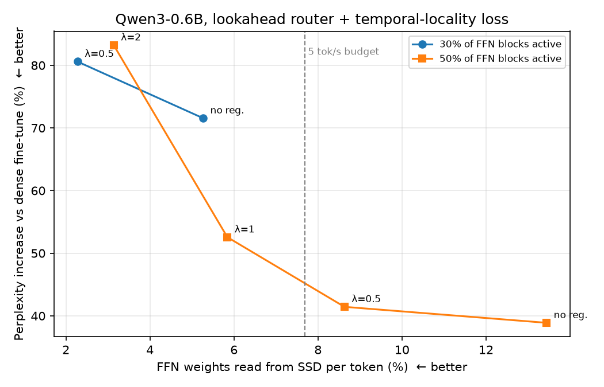

# LLM memory bottleneck: experiments on a 16 GB MacBook

Seven small, reproducible experiments around one question:
**can a language model need less memory traffic per token — by predicting what it needs, loading
less, or being built differently — without losing much quality?**

Everything ran on an **Apple M1 Pro with 16 GB RAM** (PyTorch + MPS), mostly with **Qwen3-0.6B** and
WikiText-2. No GPU rental. This is a **measurement and reproduction study**: most ideas tested here
are already published (see [Related work](#related-work)). The value is in honest, rerunnable numbers
on consumer hardware — including the negative results.

## Key findings

| # | Question | Answer (on this small scale) |
|---|---|---|
| 1 | Can we predict which FFN neurons will fire and skip the rest? | Yes, partly. An oracle keeping 30% of neurons costs +9% perplexity; a 3-bit weight sketch predicts almost as well as the oracle. Cheap "registers" (static tables, token-ID tables, sliding windows) are far worse; a sliding window collapses into a static set |
| 2 | Do neurons form groups that could be read from SSD in large blocks? | Not in a pretrained model: block selection costs ~6× more perplexity than neuron selection, and co-activation clustering does no better than file-order blocks |
| 3 | Can a short fine-tune create block structure? | Yes: block masking during training cut the cost of 30% blocks from +12% to +4% perplexity (4 layers) |
| 4 | Does a lookahead router + temporal-locality loss reduce SSD reads? | Yes, consistently: **1.6–2.3× fewer block loads** for a few % perplexity, with a clean quality-vs-traffic dial. Quality overall is still the weak link (+39–80% vs a dense fine-tune) |
| 5 | Can architectures built around the bottleneck (looped core, memory table, constant state) match a dense model? | Half way: same compute, **3.3× smaller core and 64× less context traffic**, closing ~half the gap between a small and a 4× larger dense model |
| 6 | Can a small core + external memory table *reason* over facts it stores? | Memorises 20 000 fictional people perfectly, but **cannot combine two facts (≈0%)** — unless it reasons step by step: **chain-of-thought lifts held-out 2-hop accuracy to 40%** |
| 7 | How far can weights be compressed? | **Lossless limit ≈10.6 bits/weight** (mantissas are noise). Lossy: vector codebooks + activation-aware weighting give **3.0-bit quality between scalar 3- and 4-bit** (ppl 75 vs 358 for scalar 3.5-bit). 2-bit breaks this 0.6B model without GPTQ-style correction |

## Experiments

All perplexities are on the same 16 × 512 WikiText-2 test tokens unless stated otherwise.
Dense Qwen3-0.6B: **34.2**.

### 1. Predicting active neurons — `sparsity_exp.py`

Keep only the top-k FFN neurons per token, chosen by different predictors (perplexity at 30% of neurons):

| Predictor | Memory per neuron | PPL @30% |
|---|---|---|
| oracle (top-k by true activation) | – | 37.2 |
| 4-bit / 3-bit / 2-bit weight sketch | 17% / 12.5% / 8% | 38.8 / 39.8 / 48.8 |
| token-ID table + 1-bit gate sketch | ~2% | 72.2 |
| 1-bit gate sketch | 2% | 135.8 |
| token-ID table | table | 158.0 |
| static frequency table / sliding window | 0 | 404.6 / 404.6 |

A predictor that only sees neurons it already loaded (sliding window) never discovers new ones and
degenerates into the static hot set. *Note: the lookahead rows (`*_la`) saved in `results/` predate a
bug fix (they used a residual from two layers back); the code is fixed, the numbers are not rerun.*

### 2. Neuron blocks — `cluster_exp.py`

Selecting whole 48-neuron blocks (oracle, 30%) gives perplexity **207** vs 37 for single neurons.
Co-activation clustering (balanced k-means) ≈ naive file-order blocks (energy captured 0.745 vs 0.747).

### 3. Fine-tuning for block structure — `ft_exp.py`

4 middle layers, 200 steps, 30% of blocks active in those layers:

| | dense | 30% blocks | 30% neurons |
|---|---|---|---|
| base model | 34.2 | 36.7 | 34.2 |
| plain fine-tune (control) | 22.3 | 25.0 (+12%) | 22.3 |
| fine-tune with block mask | 23.5 | **23.1 (+4% vs control)** | 23.2 |

### 4. Lookahead router + temporal-locality loss — `exp4.py`

All layers, 64 blocks/layer, router sees layer *l−1*'s residual (so blocks can be prefetched).
The locality loss penalises changes in the router distribution between consecutive tokens.
SSD reads = fraction of FFN weights missed by a 50%-capacity LRU block cache per token;
tok/s is a **model estimate** (`sim.py`) for Qwen3-32B @4-bit on a 16 GB Mac, not a measurement.



| active blocks | locality weight | PPL (dense fine-tune = 29.2) | SSD reads/token | est. tok/s |
|---|---|---|---|---|
| 30% | 0 | 50.0 (+72%) | 5.3% | 7.3 |
| 30% | 0.5 | 52.7 (+81%) | 2.3% | 16.9 |
| 50% | 0 | 40.5 (+39%) | 13.4% | 2.9 |
| 50% | 0.5 | 41.3 (+41%) | 8.6% | 4.5 |
| 50% | 1 | 44.5 (+53%) | 5.8% | 6.6 |
| 50% | 2 | 53.4 (+83%) | 3.1% | 12.3 |

For reference, plain `mmap` of a 19 GB model on 16 GB reads ~8 GB/token → ~0.6 tok/s.

### 5. Architectures built around the bottleneck — `bottleneck_exp.py`

Byte-level models trained from scratch on WikiText-2, all with 8 block passes per token (same compute):

| model | val bits/byte | core weights | memory table read/token | context read/token @2048 |
|---|---|---|---|---|
| dense, 8 layers | **2.008** | 13.0 MB | – | 16.8 MB |
| looped core + memory table + retention | **2.177** | **3.9 MB** | 16 KB | **0.26 MB** |
| looped core + memory table | 2.223 | 4.1 MB | 16 KB | 16.8 MB |
| looped core (2 blocks × 4) | 2.244 | 3.5 MB | – | 16.8 MB |
| dense, 2 layers | 2.360 | 3.5 MB | – | 4.2 MB |

Replacing the growing KV cache with a constant retention state cost nothing here (it even helped).

### 6. A world of fictional people — `facts_exp.py`

20 000 made-up people (city, job, year, friend). 1-hop: "city of X?". 2-hop: "city of the friend of X?",
trained for 70% of people and tested on the other 30%. Chance level ≈ 0.5%.

| model | 1-hop memory (4 kinds) | 2-hop, held-out people |
|---|---|---|
| looped core | 100% | 0.4% |
| looped core + memory table | 100% | 0.6% |
| **looped core + memory table + chain-of-thought** (names the friend first) | 100% | **40.1%** |

The memory table learns facts faster (92% vs 69% halfway through training), but neither model composes
facts in one pass ("two-hop curse"); writing the intermediate step out makes composition possible.

### 7. Weight compression — `compress_exp.py`

**Lossless limit**, measured over all 440 M linear weights (bf16): sign 1.00 bit, exponent 2.66 of 8,
mantissa **6.97 of 7** → **10.6 bits/weight ≈ 1.5×** at best. Mantissas behave like random integers
(two of them are coprime 61% of the time — exactly 6/π²), so grouping by exponent, common divisors or
palettes cannot beat this bound.

**Lossy**, all attention + FFN matrices of Qwen3-0.6B:

| method | bits/weight | weight error | PPL |
|---|---|---|---|
| original | 16 | 0 | 34.2 |
| scalar, groups of 64 (MLX-style) | 4.5 | 9.2% | 45.6 |
| **3 additive codebooks (8-dim, 256 entries each) + activation-aware weighting** | **3.0** | 25.4% | **74.9** |
| scalar | 3.5 | 19.6% | 357.9 |
| 2 codebooks + activation-aware | 2.0 | 39.2% | 36 480 |
| 2 codebooks + Hadamard rotation | 2.0 | 32.8% | 258 593 |
| scalar | 2.5 | 46.0% | 3.2 M |
| 2 codebooks | 2.0 | 33.7% | 12.0 M |

Weight error is not what matters: codebooks reconstruct weights *better* than scalar 2-bit yet break the
model more, until the error is weighted by input importance (E[x²] of each input channel), which helped
330× at 2 bits and made 3-bit codebooks clearly beat scalar 3.5-bit. The codebooks (2–3 × 8 KB) fit in L1.

### Throughput model — `sim.py`

A back-of-envelope model (RAM 200 GB/s, SSD ~5 GB/s large reads, ~1.5 GB/s small random reads) for a
model larger than RAM. Key takeaway: small random reads lose to large sequential ones even with a perfect
predictor, and any per-token weight streaming is bounded by `bytes/token × tokens/s ≤ disk bandwidth`.

## Reproduce

```bash
python3 -m venv .venv && .venv/bin/pip install -r requirements.txt
.venv/bin/python sparsity_exp.py all          # exp 1
.venv/bin/python cluster_exp.py all           # exp 2
.venv/bin/python ft_exp.py                    # exp 3
.venv/bin/python exp4.py ctrl r_look r_look_tl                         # exp 4, 30% blocks
FRAC=0.5 P2=300 RAMP=150 .venv/bin/python exp4.py r_look r_look_tl     # exp 4, 50% blocks
FRAC=0.5 P2=300 RAMP=150 TL_W=1.0 .venv/bin/python exp4.py r_look_tl   # locality weight 1.0
.venv/bin/python bottleneck_exp.py            # exp 5
.venv/bin/python facts_exp.py loop loop_mem loop_mem_cot   # exp 6
.venv/bin/python compress_exp.py              # exp 7
.venv/bin/python make_plots.py
```

Runtimes on an M1 Pro range from minutes to ~1.5 h per variant. Run long variants in separate processes
(MPS memory is not visible in `ps` RSS; if training suddenly slows 4×, you are swapping).

## Limitations

Small models (0.6B pretrained, a few M parameters trained from scratch), one dataset, short schedules,
**one seed per variant**, perplexity/accuracy only (no downstream benchmarks), and simulated — not
measured — tokens per second. Effects at 7B+ are untested.

## Related work

The ideas tested here are published; this repo reproduces and combines them on consumer hardware.

- Activation sparsity & predictors: Deja Vu, [PowerInfer](https://arxiv.org/abs/2312.12456),
  [LLM in a Flash](https://arxiv.org/abs/2312.11514), [TEAL](https://arxiv.org/abs/2408.14690),
  [SparseInfer](https://arxiv.org/abs/2411.12692), [NeuroPrefetcher](https://arxiv.org/abs/2608.22643)
- Dense→sparse conversion, lookahead routing: [Read-ME](https://proceedings.neurips.cc/paper_files/paper/2024/file/d298cf34e4539f9134db7f38b42f69fe-Paper-Conference.pdf),
  [Continual LLM Upcycling](https://arxiv.org/abs/2606.10722)
- Temporal locality of routing: [ReMoE](https://arxiv.org/abs/2605.27081), [StickyMoE](https://arxiv.org/abs/2607.08780),
  [Temporally Extended MoE](https://arxiv.org/abs/2604.20156), [Cacheable by Design?](https://arxiv.org/abs/2608.18261)
- Memory layers & looped models: product-key memory (Lample et al. 2019), Memory Layers at Scale (Meta 2024),
  Universal Transformer, recurrent-depth models (Geiping et al. 2025), RetNet
- Two-hop reasoning failures and chain-of-thought: "two-hop curse" literature; Allen-Zhu & Li, Physics of Language Models
- Weight compression: AQLM, [QuIP#](https://arxiv.org/abs/2402.04396), [QTIP](https://arxiv.org/abs/2406.11235),
  [Leech lattice VQ](https://arxiv.org/abs/2603.11021), AWQ, GPTQ, DFloat11

## License

MIT — see [LICENSE](LICENSE).
